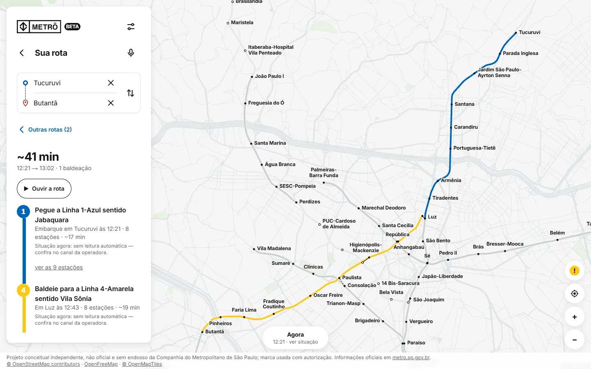
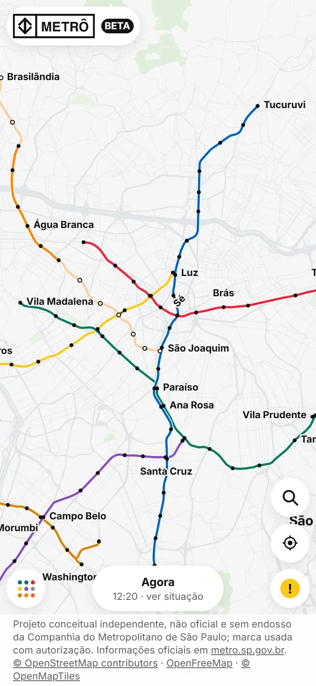
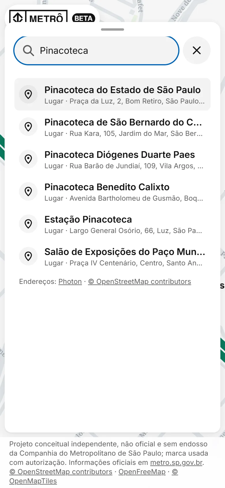
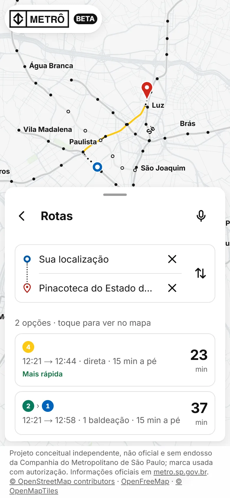
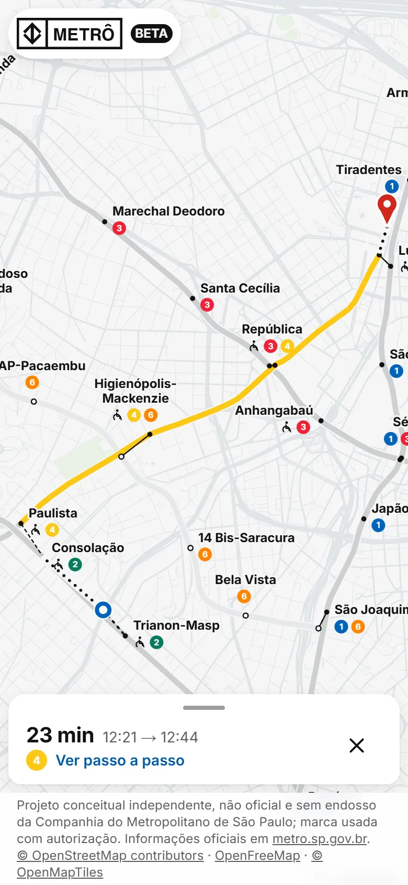
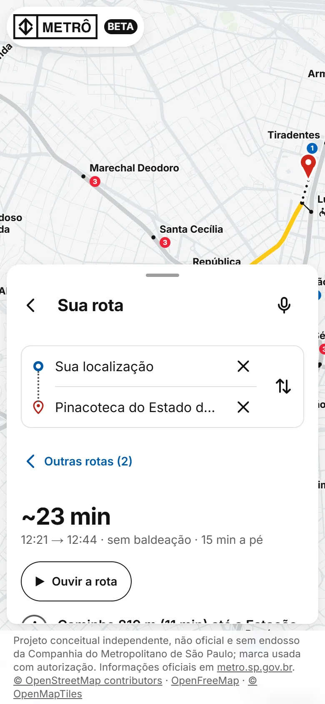
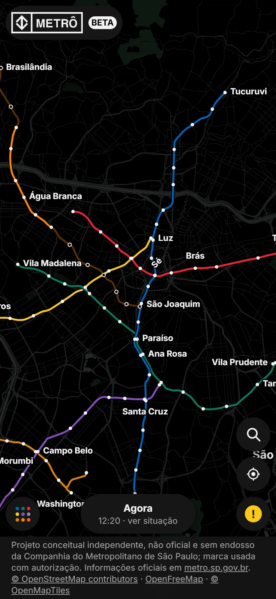

# Metrô (beta)



Mapa vivo da rede sobre trilhos de São Paulo — metrô, monotrilho e trens metropolitanos — pensado como um app de mapas: abre direto no mapa, com o traçado real por padrão (o esquemático continua como opção). Você digita para onde quer ir, ele mostra as opções de rota, você escolhe uma e o mapa desenha o caminho de porta a porta, com os trechos a pé, horários oficiais quando existem, acessibilidade e voz.

**No ar:**

- Versão completa (Vercel): https://metro-sp-beta.vercel.app
- Versão estática (GitHub Pages): https://bragahauser-byte.github.io/metro-sp/

Projeto conceitual independente, não oficial e sem endosso da Companhia do Metropolitano de São Paulo. Informações oficiais em [metro.sp.gov.br](https://www.metro.sp.gov.br).

## Homenagem ao Live Subway Map (MTA · Work & Co)

A linguagem visual deste projeto é uma homenagem ao **[Live Subway Map](https://map.mta.info)** do metrô de Nova York, criado pela **[Work & Co](https://work.co)** para a MTA em 2020: faixas paralelas com fio branco quando várias linhas correm juntas, curvas de raio constante, estações como pontos pretos, zoom semântico e a passagem suave entre o diagrama e o mapa real. Aqui essa ideia foi trazida para a rede de São Paulo, com as cores oficiais de cada linha.

É uma homenagem pessoal, **sem fins lucrativos** e sem nenhuma relação comercial com a MTA ou com a Work & Co. Todo o código e o desenho do mapa foram feitos do zero para este projeto.

## Como é no celular

A busca funciona como no Google Maps e no Apple Maps: toque na lupa, digite o destino (estação, endereço, CEP ou lugar) e escolha um resultado. A folha fica na metade da tela com as **opções de rota** — tempo, horário de saída e chegada, baldeações e minutos a pé — enquanto o mapa já mostra a mais rápida. Ao tocar numa opção a folha desce, o mapa enquadra a rota inteira e fica embaixo só o resumo; "Ver passo a passo" sobe a folha de novo.

| Mapa | Busca | Opções de rota | Rota escolhida | Passo a passo |
|---|---|---|---|---|
|  |  |  |  |  |

Tema escuro:



## Marca

O logotipo e o símbolo do Metrô são usados **com autorização** da Companhia do Metropolitano de São Paulo, sempre em uma cor só — preto no tema claro e branco no escuro, sem cores aplicadas e sem alteração de desenho. Na interface aparece o símbolo em bloco (quadrado com o símbolo vazado) ao lado do nome; a marca completa (símbolo + METRÔ) fica na tela de abertura e na imagem de compartilhamento. Os vetores estão em [`components/ui/metro-logo.tsx`](components/ui/metro-logo.tsx). A autorização não transfere nenhum direito sobre a marca, que continua pertencendo ao Metrô; ela não pode ser reutilizada a partir deste repositório e o uso aqui não significa endosso institucional ao projeto.

## O que tem

- **Mapa em tela cheia** com abertura curta (só enquanto carrega). Painel flutuante compacto: modo do mapa (Real / Esquemático), linhas, interruptor dos trens metropolitanos (7 a 13) e o botão de busca. No celular, folha com três estados (recolhida, meio, expandida), arrastável; Esc e o botão voltar fecham e o foco volta para quem abriu.
- **Localização ao abrir (v1.5):** aviso curto e o pedido do navegador logo depois. Permitida: o mapa centra em você (ponto azul) e "Sua localização" vira a origem padrão. Negada ou com erro: tudo continua funcionando; a origem vem da busca e "Usar minha localização" explica como liberar. `watchPosition` só enquanto a rota está aberta. Nada vai para o servidor nem fica salvo.
- **Busca por qualquer lugar:** estações (na hora, sem rede) e lugares/endereços — endereço com número, CEP (com ou sem traço), bairro, nome de lugar (“MASP”, “Allianz Parque” → Nubank Parque). Ordem: o que bate com o texto primeiro, depois o mais perto. Carregando, "nada encontrado" com sugestões e erro claro; nunca trava.
- **Rota de porta a porta:** para cada ponta que é um lugar, as 3 estações mais próximas (2 km, ampliando para 3,5 e 5 km); escolhe a combinação de menor tempo total (a pé + rede + a pé). Caminhada sempre rotulada como estimativa (linha reta × 1,3 a 4,5 km/h). No mapa: marcadores de origem e destino e o trecho a pé tracejado. Mais de 3 km da rede: aviso com a estação mais próxima e o botão para usá-la; mais de 5 km: sem rota a pé, mas com a estação mais próxima.
- **Passo a passo:** "Caminhe 450 m (6 min) até a Estação Paraíso" → "Pegue a Linha 2-Verde sentido Vila Prudente" → "Baldeie para a Linha 1-Azul sentido Jabaquara" → "Desça em Saúde" → "Caminhe 300 m até o destino", cada passo com a cor e o número da linha, o sentido, as paradas, o tempo e a situação agora da linha (alteração em destaque; "sem leitura automática" quando não há fonte). Tocar num passo leva o mapa até ele.
- **Horários:** só de fonte oficial consultada (Metrô; Motiva para 4, 5, 8 e 9). Sem fonte = "horário não verificado", nunca tratado como aberto.
- **Busca → opções → rota (v1.6):** escolhido o destino, a lista de rotas aparece primeiro (mais rápida marcada); tocar numa delas fecha a folha e mostra a rota no mapa, com resumo embaixo e "Outras rotas" para voltar. Horário de saída/chegada e prioridade a estações acessíveis ficam em "Horário e acessibilidade".
- **Celular como o Live Subway Map:** marca do Metrô (abre os ajustes) no alto; embaixo, botão de linhas, pílula **Agora** e avisos; à direita, busca e localização. A busca abre como no Apple Maps: campo + fechar, **Recentes** (só neste navegador) e **Buscar por perto** (shoppings, farmácias, restaurantes num raio de 2 km do centro do mapa).
- **Agora (situação das linhas, a cada 15 min):** Linhas 10–13 pelo mesmo endpoint público que o site da CPTM usa; Linhas 4–9 pela API da ARTESP quando `ARTESP_API_KEY` estiver configurada; Linhas 1, 2, 3, 15 e 17 sem leitura automática (o Metrô não publica a situação em formato aberto) — o site mostra o link do canal oficial em vez de supor "normal". Links para TemTrem, ARTESP, Metrô e CPTM (site e X) e concessionárias.
- **Avisos:** comunicados do feed RSS do Metrô, conferidos a cada 15 min, com última atualização bem-sucedida separada da data de cada comunicado.
- **Voz:** dizer a rota ("de Rua Otávio Alves Dundas até Shopping Eldorado"), com confirmação quando há mais de um lugar possível; ouvir a rota com tocar, pausar, continuar e parar; bipe opcional (nunca o único aviso).
- **Acessibilidade:** alvos de 48 px, foco gerenciado, anúncios para leitor de tela, alternativa em texto do mapa, tema Claro/Escuro/Sistema, texto maior, mais contraste e reduzir movimento (no ícone de ajustes, junto com Sobre, fontes e Estilo).

Endereços antigos continuam funcionando: `/mapa`, `/linhas`, `/linhas/4`, `/estacoes/se`, `/rota`, `/como-chegar`, `/perto-de-mim` e `/sobre` levam ao mapa com o painel certo aberto.

## Rodar, testar e buildar

```bash
npm install
npm run dev            # http://localhost:3000
npm test               # node --test: rotas, horários, avisos, voz, geocodificação, caminhada (Node ≥ 22.6)
npm run lint
npx next typegen && npx tsc --noEmit
npm run build          # build da Vercel (com /api)
npm run build:pages    # build estático do GitHub Pages em out/ (base /metro-sp/)
```

Dados: `npm run data:fetch` → `npm run data:build` → `npm run data:schematic` → `npm run validate`. Fontes e datas em [`data/sources.md`](data/sources.md); horários em [`data/horarios.json`](data/horarios.json).

## Variáveis de ambiente

Nenhuma é obrigatória. A geocodificação (Photon) não usa chave.

| Nome | Onde | Para quê |
|---|---|---|
| `CRON_SECRET` | Vercel (Settings → Environment Variables) | Libera `GET /api/avisos/atualizar` com `Authorization: Bearer <segredo>` (força nova coleta de avisos). Sem ela o endpoint responde 503; os avisos continuam se atualizando sozinhos a cada 15 min. |
| `ARTESP_API_KEY` | Vercel (Settings → Environment Variables) | Liga a situação das Linhas 4 a 9 (API do CCM da ARTESP). A chave é pessoal: peça em https://ccm.artesp.sp.gov.br → Minha Conta → Minhas APIs. Endpoint "Status em Tempo Real" (`/metroferroviario/api/status/`), cabeçalho `Authorization: Api-Key <chave>`. Limite de 12 req/h — o site lê no máximo 4 por hora (uma vez a cada 15 min por instância). Usada só na função da Vercel, nunca no navegador nem no build do Pages. Sem ela, ou com 401/403/429/tempo esgotado, as linhas 4–9 aparecem como "sem leitura automática" com link da ARTESP. Se a ARTESP responder 403, a chave tem lista de IPs: a Vercel não tem IP fixo, então deixe a lista vazia no portal. |
| `DEPLOY_TARGET=pages` | só no build | Usado por `npm run build:pages`; não configure na Vercel. |

## Geocodificação

Provedores: **[Photon](https://photon.komoot.io)** (komoot) na digitação e **[Nominatim](https://nominatim.org)** de reforço, os dois do OpenStreetMap e sem chave. A política do Nominatim (https://operations.osmfoundation.org/policies/nominatim/) proíbe autocomplete no navegador e pede no máximo 1 req/s, identificação e cache: por isso ele só é chamado **no servidor**, quando o Photon não acha nada que bata com o texto, numa fila de 1 req/s, com User-Agent/Referer e cache de 1 dia. No Pages (sem servidor) só o Photon.

- Vercel: `/api/geocode` faz proxy com cache (CDN 1 dia, memória 1 h), limite por IP (30/min) e teto global (120/min), User-Agent identificável.
- Pages: o navegador chama o Photon direto (CORS liberado), com mínimo de 3 letras, espera de 300 ms e cancelamento das buscas antigas.
- Apelidos (MASP, Allianz Parque) e CEP sem traço são tratados antes da consulta. Resultados ordenados por: nome igual → começa com o texto → todas as palavras → distância (do GPS, calculada só no aparelho, ou do centro do mapa).
- Só o texto digitado (e, sem GPS, o centro do mapa arredondado) é enviado; a localização do GPS nunca. Atribuição "Photon · © OpenStreetMap contributors" aparece nos resultados.

## Vercel × GitHub Pages

| | Vercel | GitHub Pages |
|---|---|---|
| Mapa, linhas, estações, rotas entre estações, horários | sim | sim |
| Busca de endereços e lugares | via `/api/geocode` (cache + limite) | direto no Photon |
| Avisos e situação das linhas (Agora) | sim (`/api/avisos`, a cada 15 min) | não — mostra "disponível na versão completa" e os links dos canais |
| Buscar por perto | via `/api/geocode?perto=` | direto no Photon (`/reverse`) |
| Atualização forçada de avisos | `/api/avisos/atualizar` com `CRON_SECRET` | não |
| Endereços antigos | redirecionamento 308 no servidor | redirecionamento no navegador |
| Imagem de compartilhamento (OG) | sim | não |

A versão do Pages mostra o selo "Versão estática — versão completa em metro-sp-beta.vercel.app". Publicação: workflow [`.github/workflows/pages.yml`](.github/workflows/pages.yml) (testes, lint, tipos e build; se algo falhar, nada é publicado).

Stack: Next.js 16 (App Router, Cache Components) + TypeScript + Tailwind CSS 4 + MapLibre GL. Regras do projeto em [`CLAUDE.md`](CLAUDE.md).
